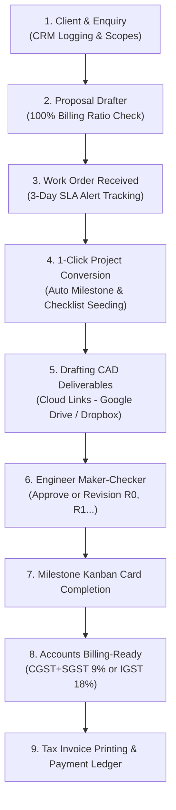

# Siddhivinayak MEP LLP — Complete ERP System Presentation & Operational Guide

> [!NOTE]
> **Executive Purpose**: This document is an executive-ready operational manual and presentation guide for the **Siddhivinayak MEP LLP ERP System**. It is structured for presenting to engineering partners, clients, or MEP teams to explain the complete system architecture, modules, and end-to-end workflow without getting bogged down in low-level code details.

---

## 🏢 1. Executive Summary & Scale

This ERP is purpose-built specifically for **MEP Engineering Consultancies** (Mechanical, Electrical, Plumbing, Fire Fighting, HVAC, and BIMS). It automates the entire business lifecycle from the initial client enquiry to drawing drafting, engineering approvals, and GST milestone billing.

* **Live Database Capacity**: Managing **1,790+ Active & Historic Projects** and **1,460+ Onboarded Clients**.
* **Zero Calculation Errors**: Mathematical 100% ratio enforcement on all consultancy milestone proposals.
* **Engineering Maker-Checker Protocol**: Draftsmen submit cloud drawing links; Engineers verify calculations before signing off.
* **Automated Finance Pipeline**: Once a milestone stage is completed by engineers, it is pushed directly to Accounts for State-wise GST billing.
* **Paperless & Audit Compliant**: Complete role-based access control (RBAC), SLA alerts, and full activity logs.

---

## 🔄 2. End-to-End Operational Workflow (A-to-Z)

### The 6 Core Operational Phases:
1. **Lead & CRM Initiation**: When a prospective builder or architect contacts the firm, a Client profile and Enquiry are created. MEP disciplines (HVAC, Electrical, Plumbing, Fire Fighting) are tagged. Contacting the client via WhatsApp, Phone, or Email takes just one click.
2. **Commercial Proposal & 100% Ratio Validation**: The project manager drafts the consultancy proposal. The system prevents commercial errors: the proposal **cannot be saved** unless the sum of milestone billing stages equals **exactly 100%**.
3. **Work Order (WO) Registration**: When the client approves, the signed Work Order PDF is uploaded. If a proposal is approved but the Work Order is missing for more than **3 days**, the system triggers a dashboard alert.
4. **Project Conversion & Auto-Seeding**: A single click converts the proposal into an active Project. The system automatically populates milestone due dates (in 30-day offsets) and seeds default drawing checklists for the chosen scopes.
5. **CAD Drafting (Maker-Checker Flow)**: Draftsmen (Makers) paste cloud links (Google Drive / Dropbox) for drawings. The system automatically routes checking duties to the specialized discipline engineer. If changes are requested, the revision increments (R0 ➡️ R1 ➡️ R2) with timestamped comments.
6. **Milestone Billing & GST Invoicing**: Completing a milestone card sends an automated prompt to the Accounts department. The system calculates the base milestone value, calculates Maharashtra (9% CGST + 9% SGST) or Interstate (18% IGST) tax, generates a print-ready GST tax invoice, and logs incoming payment receipts.

---

## 📸 3. System Modules & Authentic Visual Walkthrough

### Module 1: System Authentication & Role-Based Security (RBAC)
* Features individual logins for PMO, Engineers, Draftsmen, Accounts, and HR.
* CSRF security and automatic timeout guards.
* Read-only **Coordinator** account for clients and observers where forms and action buttons are disabled.

---

### Module 2: Executive PMO Dashboard & Analytics
* **Volume Metrics**: Instant counters for active projects, completed milestones, and revenue.
* **Traffic Light Project Health**: Live color badges (Green = On Track, Amber = Critical, Red = Overdue).
* **Escalations Hub**: Immediate notifications for pending stage sign-offs and missing client Work Orders.

---

### Module 3: Projects Directory & Live Filtering
* Instant search and pagination optimized for **1,790+ projects**.
* Filter projects by Project Manager, Status, Priority, and Health.
* Quick actions: Open Project 360 Cockpit, Edit Scope, or Reassign Team.

---

### Module 4: Project 360 Cockpit & Milestone Breakdown
* Comprehensive project view showing site addresses, assigned MEP teams, and scopes.
* Tower/Wing management: track individual completion percentages across multiple buildings.
* Interactive milestones tracker showing billing stages, due dates, and stage approval states.

---

### Module 5: Client Registry & CRM Action Hooks
* Master database of **1,460+ corporate clients, developers, and architects**.
* **Instant CRM Triggers**:
  * `WhatsApp`: Direct one-click chat with the client's representative.
  * `Call`: Direct click-to-call via softphone or mobile.
  * `Email`: One-click email drafting with official reference numbers.
* Central storage of Client GSTIN, billing addresses, and official contact persons.

---

### Module 6: Consultancy Proposals & 100% Billing Ratio Lock
* Configures built-up area (sq ft), project location, and proposed consultancy fees.
* Includes presets: *Standard MEP* (6 stages) & *Small Residential* (4 stages).
* **Real-time Math Validation**: The save button stays locked until milestone billing percentages total exactly 100%.
* Tracks formal Work Order (WO) receipts and triggers automated 3-day SLA follow-up alerts.

---

### Module 7: CAD Drawings Workspace (Maker-Checker Protocol)
* **Cloud Link Submissions**: Draftsmen paste shared Google Drive/Dropbox URLs to maintain single-source-of-truth file versioning.
* **Inline Verification**: Checking engineers click "View Drawing" to review CAD/PDF plans in real time.
* **Revision Counter**: Rejecting a sheet automatically increments the revision tag (R0 ➡️ R1 ➡️ R2) and logs reviewer remarks.

---

### Module 8: Milestone Billing, State-Wise GST & Accounts Ledger
* **Automated Billing Ready Queue**: Milestones completed by engineers immediately appear for invoicing.
* **Geographical GST Calculation**:
  * Maharashtra Clients: **9% CGST + 9% SGST**.
  * Out-of-State Clients: **18% IGST**.
* **Print-Friendly GST Invoice**: Produces invoices with company details, bank account info (IFSC, Account Number), and company seal placeholders.
* **Payments Ledger**: Logs partial payments, receipts, and outstanding client balances.

---

### Module 9: HR Workforce, Matrix Teams & Resource Replacement
* **Employee 360 Cockpit**: Onboarding, compliance verification (Aadhaar, PAN, Resume).
* **Transaction-Safe Peer Replacement**: If an engineer resigns or takes extended leave, a single click reassigns all active project tasks and milestones to a peer resource in a single database transaction.
* **Quarterly Appraisal Index**: 5-point rating across Technical Skills, Productivity, Communication, and Team Leadership.

---

## 🛡️ 4. Master Roles & Permission Matrix

| Role | Default Username | Scope & Key Responsibilities | Access Level |
| :--- | :--- | :--- | :--- |
| **Super Admin** | `superadmin` | Executive PMO oversight, full system audit logs, root user configuration, system configuration. | Root Access (Full Control) |
| **Admin** | `admin` | Business development, CRM enquiries, proposal drafting, WO tracking, and project conversion. | Admin (Write/Edit) |
| **Engineering** | `swapnil.mep` | Design execution workspace, milestone card completion, design remarks, and drawing review sign-offs. | Engineering (Write/Edit) |
| **Draftsman** | `kalpesh` | CAD drawing sheets maker. Cloud link uploads, sheet revision increments (R0, R1), and checklist updates. | Drafting Maker |
| **Accounts** | `accounts` | Milestone billing ready queue, state-wise GST invoice creation (CGST+SGST or IGST), and payments ledger. | Finance (Write/Edit) |
| **HR Manager** | `hr` | Employee records onboarding, compliance file uploads, matrix teams, and peer workload substitution. | HR Admin (Write/Edit) |
| **Coordinator** | `pavan` | Observer role. Read-only browsing across project directories, Gantt charts, and invoices without form editing permissions. | Read-Only Viewer |

---

## 💡 5. Presentation Quick-Tips (Dusrya MEP Team la Sangnyasathi)

1. **Highlight Scalability**: Show that the system is already handling **1,790+ live projects** and **1,460+ clients** smoothly without slowdowns.
2. **Highlight Billing Accuracy**: Emphasize that proposals enforce a **100% milestone percentage check**, eliminating accounting disputes before client review.
3. **Highlight Quality Control**: Point out the **Maker-Checker** drawing flow with Google Drive / Dropbox link verification and R0/R1 revision tracking.
4. **Highlight Automation**: Explain that when an Engineer marks a design stage complete, Accounts is instantly notified with calculated GST amounts ready to bill.
5. **Direct Presentation Option**: You can open [mep_erp_presentation.html](file:///c:/xampp/htdocs/erp/mep_erp_presentation.html) in your browser and press `Ctrl + P` -> "Save as PDF" to generate a PDF presentation deck.
